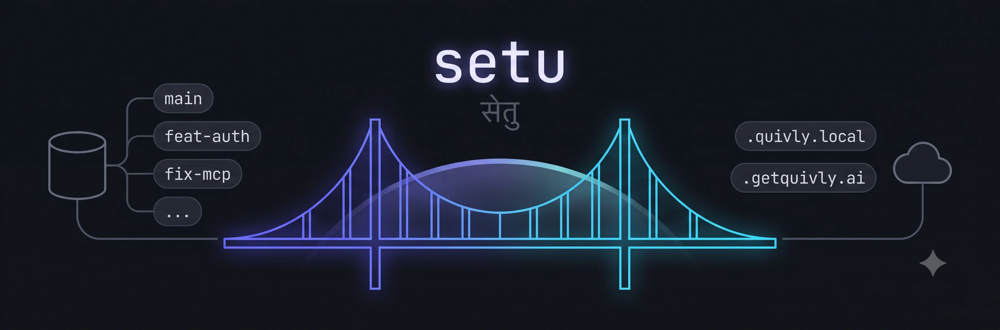

# setu



Workspace bridge — git worktrees, local `.setu.local` domains, and a shared Cloudflare tunnel.

## Install

Prerequisites are [Homebrew](https://brew.sh) and a signed-in GitHub CLI (`gh auth login`), because this repository is private. `setu setup` installs everything else itself: `bun` (via `install.sh`, if missing), `caddy`/`cloudflared`/`dnsmasq`/`direnv`/`gh`, authenticates `gh` if needed, and offers to install a container engine if none is running (`setu start` containerizes by default — real memory/CPU caps). Missing Homebrew too? `setu setup` installs that first, then asks you to re-run the same command once (a fresh process is needed to pick up its own new PATH correctly).

```bash
gh api repos/mukulchugh/setu/contents/install.sh -H "Accept: application/vnd.github.raw" | bash
setu setup
```

**Container engine choice** (only asked if none is already running): OrbStack (recommended) or Docker Desktop both need one manual first launch to finish their own setup — this isn't skippable, it's how those apps work. Colima is the only fully headless option (`brew services`, no GUI at all). Skip entirely and pass `--bare` to `setu start` if you'd rather not install one.

Non-interactive (agents / scripts): `setu setup --name <you> --yes` — defaults to Colima if no engine is running and `--engine` isn't given, since it's the only one of the three that doesn't need a human to click through a GUI app's first launch. Override with `--engine orbstack|docker|colima|skip`.

## Update

```bash
setu update                         # update while the portal is offline
setu update --restart               # authorize a guarded restart if the portal is running
setu update --restart --include-untracked  # also preserve reviewed untracked source in the recovery stash
```

The updater stops before installation or restart if local changes cannot be restored. It retains the exact recovery stash and original revision. A running portal must support guarded updates and have no active, queued or uncertain work, supporting processes, tunnel or outgoing MCP connections. Older portals require a separately reviewed manual cutover. Setu also nudges you once a day on stderr when it is behind origin.

## Something broken?

```bash
setu doctor     # checks every layer — dnsmasq, caddy, sudoers, tunnel, worktree hygiene, portal — with fix commands
```

## Commands

`--json` is accepted by the CLI parser. These are the command-specific flags.

```text
setu setup [--name X --workspace PATH --zone DOMAIN --engine orbstack|docker|colima|skip --yes]
setu doctor [--json]
setu init <gh-org>/<repo> [label]
setu sweep [--import NAME]
setu new <repo> <branch> [--tunnel --start --container|--bare]
setu rm <repo> <branch> [--force] [--operation-id ID]
setu ls [repo] | setu status
setu start <repo> <branch> [--container|--bare]
setu stop <repo> <branch>
setu prune [--force]
setu fetch <repo>
setu portal [stop]
setu mcp install <client> | setu mcp install --all | setu mcp status
setu tunnel <repo> <branch> [stop]
setu sync <repo> <branch>
setu trigger <repo> <branch> [stop]
setu logs <repo> <branch> [--type TYPE --lines N]
setu diff <repo> <branch> [--verbose]
setu ports
setu pr create|ready|status <repo> <branch>
setu storage [inspect <repo> <branch> | inspect --store ID]
setu operations [repo branch] [--since ISO --limit N]
setu sessions [list [repo branch] | end <repo> <branch> --session ID --checkout FILE|-]
setu caches prepare <repo> <branch>
setu caches execute <repo> <branch> --manifest ID --confirmation TOKEN
setu caches execute <repo> <branch> --retry FILE|-
setu admission
setu setup-progress [list [repo branch] | retry <repo> <branch> --checkout FILE|- --attempt ID [--refresh-dependencies]]
setu attention [list [repo branch] | focus <repo> <branch> --session ID --checkout FILE|-]
setu headless list [repo branch]
setu headless start <repo> <branch> --prompt-file FILE|- [--model NAME --budget USD --wall-clock-ms N --output-bytes N]
setu headless resume <repo> <branch> --run ID --prompt-file FILE|- [--model NAME --budget USD --wall-clock-ms N --output-bytes N]
setu headless cancel <repo> <branch> --run ID --checkout FILE|-
setu dependencies [status [repo branch] | verify|repair <repo> <branch>]
setu shared-caches
setu workflows list|runs <repo> <branch>
setu workflows dispatch <repo> <branch> --workflow ID --ref REF --inputs FILE|- [--confirmation TOKEN]
setu actions list | save --input FILE|- | preflight --action ID --input FILE|- | invoke --action ID --input FILE|- --confirmation TOKEN
setu adopt <repo> <branch> --path LINKED_CHECKOUT
setu review handoff <repo> <branch> --session ID --checkout FILE|- --artifact FILE|- --findings FILE|-
setu path <repo> <branch> | setu cd <repo> <branch>
setu update [--restart] [--include-untracked]
setu version | setu help
setu claim [worktree] --agent NAME --session ID --task TEXT [--pid PID]
setu release [worktree] --session ID | setu claims | setu claim-check <path> --session ID
```

`setu start` and `setu new --start` can be accepted into a queue. Check
worktree state before calling the dev server running. `rm --force`, `prune
--force` request destructive behavior. Cache execution requires the user to
confirm the reviewed manifest and submit its returned token; possession of the
token is not approval. An uncertain removal must be inspected and resumed only
with its returned operation ID. `update` and `prune` are CLI-only. Settings are
web/API-only and have no CLI or MCP command.

The complete local HTTP method/path inventory, per-operation target shapes,
confirmation and recovery requirements, front-door support, and MCP tool input
shapes are in [AGENTS.md](./AGENTS.md#complete-interface-contract). The tables
are maintained against the exported portal route catalog rather than a second
hand-maintained API list.

## Spans

Open Spans in the portal to plan a workflow or inspect Past, Live and Planned
history. Saving a reviewed draft creates a Planned entry. Import conversation
accepts one explicit local Codex or Claude conversation path and retains a bounded,
redacted page. Standalone imports appear in Past and remain read-only, with their
original provenance. You can attach selected history to an existing run instead.
Opening the page does not create an archive or scan provider directories.

Search reads the retained index. A missing index is unavailable rather than an
empty result. Offline indexing, selected-source import, backup and restore use
explicit paths and do not start the portal:

```text
setu spans list --json
setu spans import-history --input '{"path":"/absolute/conversation.jsonl","provider":"codex"}' --json
setu spans index --root /absolute/archive --json
setu spans backup --root /absolute/archive --destination /absolute/new-backup --json
setu spans restore --backup-root /absolute/backup --destination /absolute/new-archive --json
```

The read and `import-history` commands require the portal. Dashboard backup and
restore use a background child and show their reviewed destination. Neither copy
operation overwrites a path. Restore creates an inactive archive; switching the
portal to it is a separate configuration change. Keep partial or unknown
outcomes for inspection before retrying.

Settings → Agent integrations previews the bundled Spans skill and exact owned
paths for Codex, Claude Code and Cursor. Review the hashes and consumers, then
type the returned phrase to apply that review. Codex and Cursor share one owned
skill file, so removal must explicitly name both consumers. Client receipts stay
outside conversation archives. User edits and unowned files refuse replacement;
unknown results require receipt reconciliation. This flow does not configure
native MCP settings. Installed files alone do not prove a connection, fresh
session or activated skill. CLI uses `setu spans integrations status|review|apply|reconcile`;
MCP exposes preview only.

Live execution is opt-in and disabled by default. The current execution service
supports a reviewed headless Claude Code span through completion, with a local
capability probe, writer ownership, shared admission and usage tracking. A probe
or dispatch starts a real provider session and needs explicit approval. The Plan
tab guides you through preview, saved review, typed approval and Start. The exact
review digest binds dispatch; changed input or a revoked receipt is refused.
Dispatch requires a current Setu setup receipt for the checkout's Bun inputs and
installed package view. Older completed setups remain unverified. In worktree
Resources, choose Review dependency refresh and confirm the reinstall, or use
`setu setup-progress retry REPO BRANCH --checkout IDENTITY.json --attempt ID --refresh-dependencies`.
Use the exact current attempt and checkout identity from setup progress. This
explicit action may run package installation scripts and clears previous readiness
until the owned install succeeds. Reads never install dependencies. Records without
a verifiable checkout or attempt identity need individual review first.

Private hoisted installs can qualify for Spans readiness. Shared isolated installs
require healthy Setu-owned links. Shared hoisted installs require a completed
enrollment matching the current setup receipt and dependency view. Refresh never
converts an unmanaged or replaced dependency view. Older saved execution reviews
remain readable and revocable, but a new approval or Start needs a fresh receipt
binding.

Approval and retained capture survive a portal restart. A detached child owns the
provider and output capture, and reconciliation observes the existing attempt
without launching it again. Stop confirms delivery separately from exit. An
incomplete capture stays held, with its available evidence and resources retained.

The cmux transport has an archive adapter that retains delivery phases in the
existing event log. Restarted transports read the retained intent before sending,
and a possibly committed write blocks a resend. Those archive and transport
fixtures do not establish native cmux delivery; its production adapter remains
unconnected.

The built-in execution profile uses Claude Code. Luna execution remains unavailable
until the client can prove configuration isolation while retaining subscription
authentication. Configured model and effort do not prove the model that served a
turn, and no model is substituted automatically. Local process fixtures verify
capture and recovery; browser acceptance, native provider acceptance and live
rollout remain separate checks. See
[the execution contract](./AGENTS.md#spans-execution-live-opt-in) before enabling it.

## Raycast extension

A third front door onto the same core the CLI and portal already use — lives in `raycast/`, talks to the portal's HTTP API (`localhost:2999`), nothing duplicated. Covers listing/starting/stopping/syncing worktrees and creating new ones, plus a Quick Open command that's the Raycast-native equivalent of the portal's ⌘K. Also ships as an [AI Extension](https://developers.raycast.com/ai/learn-core-concepts-of-ai-extensions) — Raycast's own AI can call `list-worktrees`/`start-worktree`/`stop-worktree`/`sync-worktree` directly from natural language.

`setu setup` checks for Raycast and prints this step if it's installed (there's no headless way to register a local extension — it goes through Raycast's own Import/Develop flow):

```
cd raycast && bun install && bunx ray develop
```

Requires `setu portal` to be running — the extension has an explicit "portal isn't running" state rather than failing silently.

A removal without `--force` refuses tracked or untracked changes, ignored local env files that are real files (a symlinked `.env.local` is fine), and commits that only a detached HEAD holds. A worktree named `main` is never removed, because it holds the real `.env.local` the others link to. Setu's own generated files are git-excluded automatically and do not count.

Removal can finish deleting a checkout while later cleanup fails. Setu reports `removed: true` with an operation ID and pending steps, keeps the port reserved, and shows recovery independently of the deleted card. Retry with that exact ID. After an unconfirmed network response, refresh status before trying again. An unknown process or checkout identity blocks destructive work; it does not authorize deleting an owner lock.

The portal pauses view updates and polling while hidden. Returning refreshes its process observation; failed reads retain the last good display. Log reads are bounded to 256 KiB and distinguish missing, empty and unreadable output. Host storage reports the workspace filesystem; Docker VM storage stays unknown unless measured separately.

Setu warns below 20 GiB free and checks storage again before new disk-heavy work. Below 10 GiB, or when free space cannot be verified, creation, installation and new launches are refused. Stop and removal remain available. This is a preflight check, not a disk quota: running applications and other tools can still consume space after a successful check. Docker VM space is separate from host free space.

Stopping a worktree keeps its files, build output and dependency volume. Review and explicitly remove abandoned worktrees to reclaim their owned resources. Never recursively delete folders just because they are named `dist`: package caches and `node_modules` also contain required package files. Setu's shared container cache is `workspace/.bun-cache`. [Bun's cache documentation](https://bun.com/docs/pm/global-cache) explains package copying and macOS copy-on-write; summed directory sizes are not a promise of reclaimable physical space. Setu does not automatically delete caches or worktrees.

### Workspace inventory

The portal's Inventory view includes Git worktrees that are missing from Setu's
registry. Search and copy an existing checkout path before creating another.
Registered rows and linked Git worktrees have separate counts; failed repository
discovery leaves the total unknown. Inventory caches discovery for 30 seconds and
does not scan every checkout's dependencies or build output. It provides review
checks, never an automatic deletion decision. Task ownership and last use remain
unknown when Setu cannot establish them.

### Experimental host dependency sharing

Shared package downloads and installed dependency views are separate. A shared
download cache avoids repeated downloads; it does not establish that installed
packages are shared. The native installed-store path below uses isolated linking.
The separate [hoisted file workflow](docs/dependency-sharing.md) keeps hoisted
paths and requires a reviewed conversion; neither path adopts existing views automatically.

Sharing is off by default and applies only to explicitly named fresh checkouts.
All participating projects and worktrees use one centrally configured store.
Bun's native global store installs eligible package content once and links each
checkout's `node_modules` to its required dependencies, using isolated linking
and a frozen lockfile. Source worktrees stay in place.
Compatible package graphs share targets; different versions and peer graphs keep
their own targets. Local workspace packages, patched packages and trusted packages
retain their local installation behavior.

The tested installer is **Bun 1.3.14 on macOS arm64**. Setu verifies the selected
executable instead of relying on `PATH` or upgrading the app's runtime. The
`copyfile` backend avoids a cold concurrent `clonefileat` failure reproduced in
the pilot. This is not a claim that every application toolchain is compatible.

For reviewed targets, provision one private, owned directory with
mode `0700` outside the managed workspace and disposable cache/temp directories.
Set its location and installer once in `dependencySharing` in `~/.setu.json`;
the `targets` map selects exact repository/branch names with boolean values.
`"<repo>/*": true` opts in every worktree of a repository, including ones created
later; an exact `"<repo>/<branch>": false` still opts one out:

```json
{
  "dependencySharing": {
    "enabled": true,
    "executable": "/absolute/path/to/bun-1.3.14",
    "version": "1.3.14",
    "storeRoot": "/Users/you/.local/share/setu-dependencies",
    "targets": {
      "my-project/feature/example": true,
      "another-project/main": true
    }
  }
}
```

Merge this setting into existing configuration; do not replace the rest of the
file. A target cannot override the store or installer. CLI and portal setup use
the same policy and reject malformed sharing configuration before creating a
checkout. The checkout needs a regular
`bun.lock` and no existing root `node_modules`; existing views are never converted
automatically. Normal setup remains unchanged for every other target.
Dependency repair returns a proposed command only; it does not run an install
or replace the existing view.

The earlier per-target policy map must be migrated explicitly: move the shared
store/installer fields to the central setting and list target names under
`targets`. Setu rejects that old configuration with a migration error; it does
not silently fall back to copied installs. If old targets use different stores,
review their existing consumers before selecting a central store. This setting
does not move or delete any existing package content.

The store's platform/runtime namespace is shared across projects; package
versions and resolved peer/dependency graphs remain distinct inside it. The
`copyfile` install backend populates the store and package-manager-required local
entries; it does not disable the global store's symlinks for eligible packages.
Patched/trusted packages and packages tied to local workspace paths can remain
local. Their presence must be measured rather than reported as full deduplication.
The status explanation identifies observed local fallback data, but does not
measure disk savings. Directory sizes and APFS copy-on-write observations do
not establish unique physical reclaim.

External-SSD migration is not enabled by this configuration example. It requires
verified volume identity and missing-drive handling before existing consumers
are converted. Real application builds and migrations remain separate acceptance
checks; tiny shared-store fixtures do not establish compatibility with a real project.

The protected store contains **live dependency targets**. Keep it after removing
a checkout, exclude it from cache cleanup, and do not prune it while consumers
remain. Removing the opt-in stops future shared installs; it does not detach
existing links. Container and agent-container sharing remain disabled pending
separate Linux runtime and toolchain verification.

Production deployment requires a current target preflight and explicit confirmation. The verified adapter supports Vercel 58.9.1 team-linked projects with an exact project and team. Netlify preview retains explicit site binding; Netlify production/custom targets and unverified Convex deployment adapters stay unavailable with an explanation. No deployment is used to discover a target.

## How it works

- Each worktree gets an auto-assigned port and a `<branch>.setu.local` domain via Caddy
- One shared Cloudflare tunnel URL (`dev-<name>.<your-zone>`) — `setu tunnel` moves it between worktrees
- The portal (`http://setu.local`) owns all long-running processes: dev servers, inngest, trigger.dev, cloudflared, and any configured sidecars — `setu start`/`setu stop` (or the portal UI) reach it directly, so nothing gets started outside its tracking
- Concurrent dev servers are capped (`maxConcurrentDevServers` in `~/.setu.json`, default 3) — starting beyond the cap queues automatically and starts as a slot frees up, backed by a memory watchdog that restarts any single server that grows past a configured ceiling
- `setu start` runs a worktree's dev server in a Docker-compatible container — real cgroup-enforced `containerMemoryLimit`/`containerCpuLimit` (`~/.setu.json`, defaults `4g`/`2`, auto-clamped to whatever the engine itself actually has available) instead of the polling watchdog — **unless that worktree has only ever run bare before, in which case plain `setu start` keeps it bare.** The default is sticky per worktree, not a flat global switch: a brand-new worktree (or one that's already containerized once) defaults to a container; an established worktree with bare-only history stays bare until you explicitly pass `--container`. `--bare`/`--container` always force a specific mode regardless of history. Only the dev server itself is containerized — the portal, Caddy, dnsmasq, and git all stay native on the host, this only governs how the dev server process runs. Works with any Docker-API-compatible engine (OrbStack, Docker Desktop, Colima, …), not hardcoded to OrbStack — Caddy always proxies to `localhost:<port>` exactly like the bare path, so nothing about routing changes between the two. Full details are in [AGENTS.md](./AGENTS.md#container-mode-the-default-since-2026-08-10) (heading: "Container mode")
- Which "open in &lt;agent&gt;" buttons the portal shows isn't hardcoded — it detects installed AI coding CLIs live via `which` (see `AGENT_CLIS` in `lib.js`)
- Sidecar processes beyond Inngest/Trigger (a plain tunnel, a queue worker, anything project-specific) are configurable per-project via `$WORKSPACE/sidecars.json` — not hardcoded to any one repo's toolchain
- Config lives at `~/.setu.json`; shared logic in `lib.js` (used by both `cli.js` and `portal.js`)
- Agents: see [AGENTS.md](./AGENTS.md) for `--json` interfaces and the portal HTTP API

## Safety and resource behavior

The portal listens on `127.0.0.1:2999`. HTTP, WebSocket, and MCP requests must come from
loopback with a trusted local Host and Origin. The local Caddy address `setu.local`
works; forwarded remote clients are rejected. This is a local tool, without multi-user authentication.

Removal checks tracked and untracked changes before stopping a worktree. Use `--force`
(or MCP `force: true`) only when discarding those files is intended. Git branches remain.

Container starts share the engine CPU budget and 90% of its memory. The remaining 10%
is reserved for the engine. Starts queue when either the engine budget or the configured
server count is full. The status response reports effective limits; settings retain the
requested values. Native sidecars use the footprint watchdog and are outside container cgroups.

Log retention checks open logs every five seconds and keeps the newest 2.5 MB when a log
exceeds 5 MB. It preserves the inode so running children can keep writing. This diagnostic
copytruncate policy can lose a concurrent line during trimming and allows bursts between checks.

## Verification

After installing the root and Raycast dependencies, run `bun run verify` for lifecycle,
security, resource, log, and cost regression checks plus separate portal and Raycast type checks.
The repository-wide `bun run check` also applies the existing Ultracite style rules.

For the opt-in isolated and hoisted workflows, native helper build, exact review IDs and recovery limits, see [Shared dependencies](docs/dependency-sharing.md).
