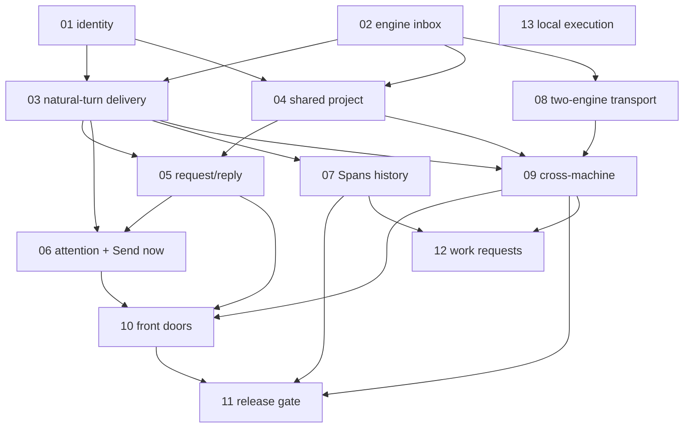

# Setu Links: ticket index

Parent: [specification](../spec.md), published as [issue #7](https://github.com/mukulchugh/setu/issues/7). Evidence limits: [TEST-BOUNDARIES.md](../TEST-BOUNDARIES.md). Code seams: [seams.md](../seams.md).

**Status: published.** The 13 slices are GitHub issues #8–#20 (ticket NN is issue #NN+7). The issues are authoritative; these files mirror them as of 2026-10-17 and are not a place to change scope. 21 native blocking links were verified by the parent, and re-read through the read-only API for this sync (they match the table below). Nothing in this repository was published from here.

## Tickets

| # | Issue and ticket | Increment | Release scope | Blocked by |
| --- | --- | --- | --- | --- |
| 01 | [#8](https://github.com/mukulchugh/setu/issues/8) · [Managed Claude sessions carry a durable, authenticated native conversation identity](01-managed-session-native-identity.md) | 2 | First release | none |
| 02 | [#9](https://github.com/mukulchugh/setu/issues/9) · [Setu-owned engine: durable local inbox with honest statuses](02-engine-local-inbox.md) | 1 | First release | none |
| 03 | [#10](https://github.com/mukulchugh/setu/issues/10) · [A queued message reaches the exact managed Claude conversation at its next normal turn](03-natural-turn-delivery.md) | 2 | First release | 01, 02 |
| 04 | [#11](https://github.com/mukulchugh/setu/issues/11) · [Enable a shared project and discover its managed sessions](04-shared-project-directory.md) | 2 | First release | 01, 02 |
| 05 | [#12](https://github.com/mukulchugh/setu/issues/12) · [Two real sessions exchange a request, a reply and an FYI](05-session-tools-request-reply.md) | 2 | First release | 03, 04 |
| 06 | [#13](https://github.com/mukulchugh/setu/issues/13) · [Attention requests notify the person; only the receiving user can Send now](06-attention-and-send-now.md) | 2 | First release (wake may ship unavailable) | 03, 05 |
| 07 | [#14](https://github.com/mukulchugh/setu/issues/14) · [A run-linked exchange appears once in Spans history](07-spans-history-projection.md) | 3 | First release | 03 |
| 08 | [#15](https://github.com/mukulchugh/setu/issues/15) · [Two engines exchange a message with durable retry](08-transport-two-peer-exchange.md) | 1 | First release | 02 |
| 09 | [#16](https://github.com/mukulchugh/setu/issues/16) · [Teammates on separate machines exchange messages](09-cross-machine-teams-messaging.md) | 5 | First release | 03, 04, 08 |
| 10 | [#17](https://github.com/mukulchugh/setu/issues/17) · [Every front door agrees, and uncertain operations are recoverable](10-front-door-parity-and-recovery.md) | 6 | First release | 05, 06, 09 |
| 11 | [#18](https://github.com/mukulchugh/setu/issues/18) · [Clean install to uninstall works, with recoverable upgrades](11-release-lifecycle-verification.md) | 7 | First-release gate | 07, 09, 10 |
| 12 | [#19](https://github.com/mukulchugh/setu/issues/19) · [A teammate's work request is approved locally and selected evidence returns](12-cross-machine-work-requests-evidence.md) (no execution) | 5 | Release-optional | 07, 09 |
| 13 | [#20](https://github.com/mukulchugh/setu/issues/20) · [A planned span runs on one real local worker](13-local-spans-execution.md) | 4 | Live execution follow-on | none |

There are 13 tickets, one over the requested range. Ticket 12 is release-optional and 13 is the follow-on, so the first-release path is 01–11.

## Dependency graph

## Start here

**Run 01 ([#8](https://github.com/mukulchugh/setu/issues/8)) and 02 ([#9](https://github.com/mukulchugh/setu/issues/9)) in parallel.** They have different owners and different bulk work: 01 is JavaScript session identity, 02 is the Rust engine plus its client and CLI. They are not code-disjoint. Both may touch different hunks of shared files, such as the CLI command table, the portal route and dispatch tables, and the package test and file lists. Separate writers should keep those edits small and localized, and integration is reviewed rather than assumed to merge cleanly. They meet at the contract in the spec (the native conversation shape on the session record, and the message states). Neither can use the other's output until 03, which is the first useful end-to-end slice.

Why not more: 03 and 04 need both 01 and 02. 08 needs only 02 and can start the moment 02 lands. 13 is independent but is follow-on by product priority; start it only if capacity is free and it does not delay 01–03.

## Unresolved external gates

| Gate | Affects | Status |
| --- | --- | --- |
| U1 managed-session prompt hook | 01, 03 | Unproven; live run in 03 |
| U7/U8 idle wake, recipient authorization | 06 | Unproven; ticket 06 can complete with Send now unavailable |
| U9/U12 cross-machine and relay | 08, 09, 12 | Untested; relay operator unresolved |
| U10 Codex | 03, 05, 11 | Unverified (not unsupported) |
| U13 reproducible Rust build | 02, 08 | The compiler (1.99.1) is verified installed locally; the engine has not yet been built or verified in CI. Reproducible provisioning is an acceptance item of 02 |
| U16 explicit authenticated cross-record resume | 03 | Not built. #8 refuses cross-record adoption and says the native-delivery slice must provide and verify the resume path |

## Conventions

- Every slice is labelled `ready-for-agent` on GitHub; a ticket that clears a gate records it in TEST-BOUNDARIES.
- Tickets avoid file paths and code snippets. Module-level pointers are in seams.md and pinned to baseline `f6dda1a`.
- Source reuse of the selected reviewed store and transport is already authorized and is not a gate; licenses and provenance live in separate legal metadata.
- Publication, labels and native blocking links are done by the parent; do not edit the remote issues from this worktree.

## Differences between the published issues and these mirrors

Reviewed 2026-10-17 by comparing every published body with the local file.

- Remote issues use `#N` references and drop relative file links; the local files add both.
- Additions the parent made to the issues, now mirrored here: #8 (agreed interface details: public `nativeConversation` shape, private digest and history of eight, duplicate live-ID refusal, cross-record resume limitation), #14 (status changes are separate immutable archive events, not duplicate message rows), #19 (conditional integration with the execution slice; it sits under Gates in the issue, and is mirrored as published).
- Open for the parent: #10 (03) still has the acceptance line "Exit and exact-resume the same native conversation", but #8 says a cross-record resume path does not exist yet and that the native-delivery slice must provide and verify one. #10 does not say so. The local spec and TEST-BOUNDARIES (U16) now record this; the issue itself was not changed.
- Parent #7's embedded copy of the spec lacks the resume qualifier added to the local spec's identity section and the link line at the top of the local spec.
